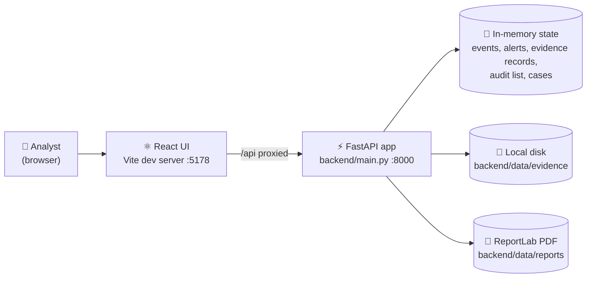
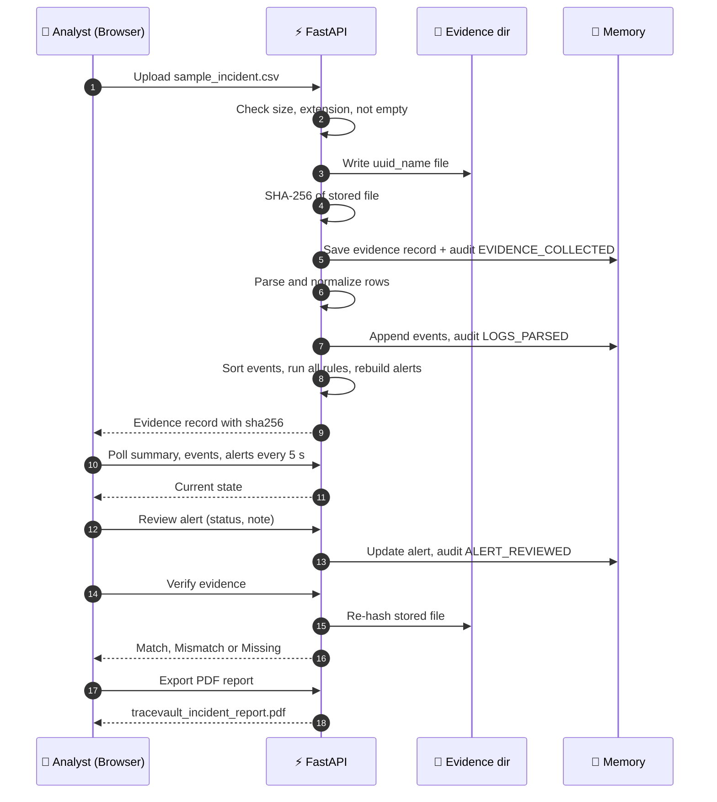
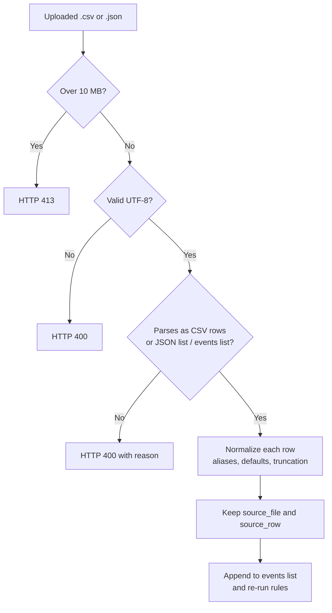
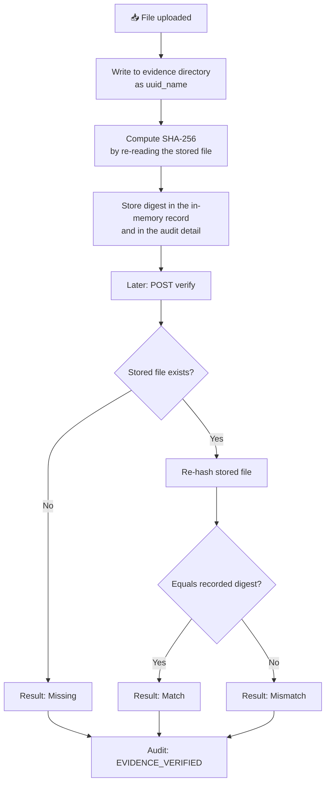
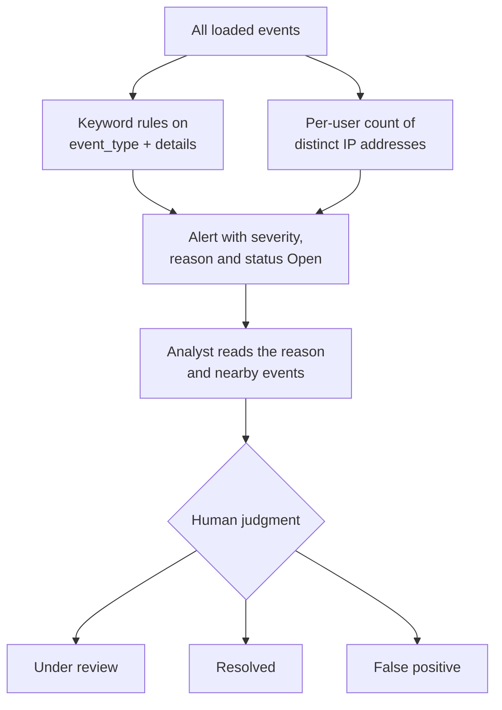
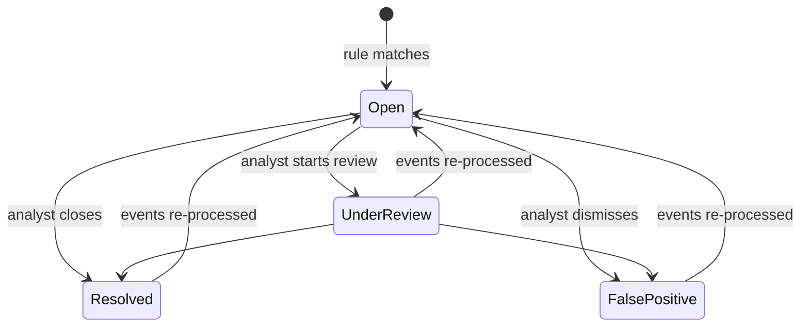
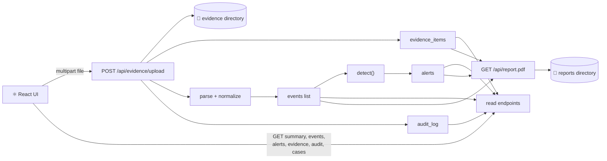
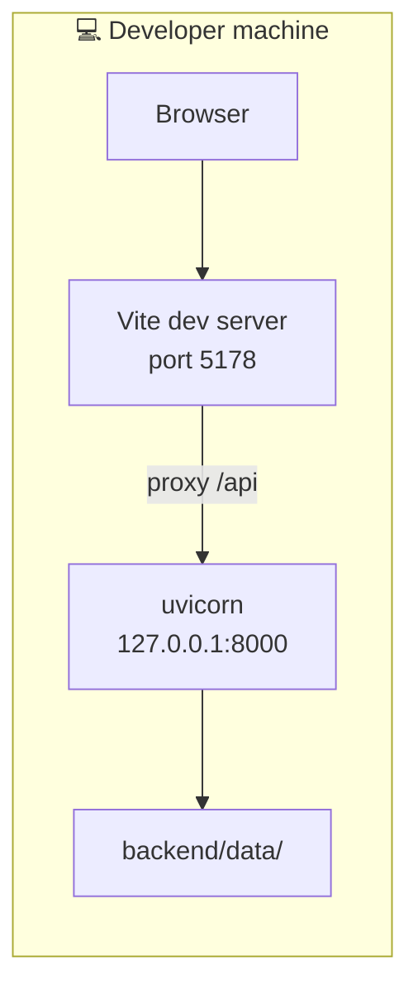

<div align="center">


# 🛡️ TRACEVAULT AI

**Threat Reconstruction, Analysis, and Chain-of-Evidence Vault**

**Import logs → build a timeline → hash the evidence → flag items for review → record decisions → export a report**

<br/>


<br/>

> *"Investigate clearly. Preserve evidence. Verify integrity. Explain findings. Maintain accountability."*

<br/>

> ⚠️ **Honest status:** a local, single-user prototype. State lives in memory, there is no login, and there is **no AI or machine learning** in the code despite the name. An alert is a prompt for human review, never proof of an attack.

<br/>

[Overview](#-1-project-overview) ·
[Status](#-4-current-implementation-status) ·
[Architecture](#-5-system-architecture) ·
[Journey](#-6-the-complete-investigation-journey) ·
[Integrity](#-9-evidence-integrity-with-sha-256) ·
[Detection](#-10-detection-rules-and-alerts) ·
[Run It](#-20-running-locally) ·
[API](#-23-api-reference) ·
[Limitations](#-26-known-limitations)

</div>

---

## 📖 Table of Contents

| # | Section | # | Section |
|---|---------|---|---------|
| 1 | [Project Overview](#-1-project-overview) | 16 | [Alert Versus Finding](#-16-alert-versus-finding) |
| 2 | [What Problem Does It Solve?](#-2-what-problem-does-it-solve) | 17 | [Technology Stack](#-17-technology-stack) |
| 3 | [Key Features](#-3-key-features) | 18 | [Project Structure](#-18-project-structure) |
| 4 | [Current Implementation Status](#-4-current-implementation-status) | 19 | [Configuration Reference](#-19-configuration-reference) |
| 5 | [System Architecture](#-5-system-architecture) | 20 | [Running Locally](#-20-running-locally) |
| 6 | [The Complete Investigation Journey](#-6-the-complete-investigation-journey) | 21 | [Demo Walkthrough](#-21-demo-walkthrough) |
| 7 | [Log Ingestion and Normalization](#-7-log-ingestion-and-normalization) | 22 | [Input Format](#-22-input-format) |
| 8 | [The Evidence Vault](#-8-the-evidence-vault) | 23 | [API Reference](#-23-api-reference) |
| 9 | [Evidence Integrity with SHA-256](#-9-evidence-integrity-with-sha-256) | 24 | [Security Posture](#-24-security-posture) |
| 10 | [Detection Rules and Alerts](#-10-detection-rules-and-alerts) | 25 | [Testing and Verification](#-25-testing-and-verification) |
| 11 | [Alert Review Workflow](#-11-alert-review-workflow) | 26 | [Known Limitations](#-26-known-limitations) |
| 12 | [Case Management](#-12-case-management) | 27 | [Troubleshooting](#-27-troubleshooting) |
| 13 | [Audit Log](#-13-audit-log) | 28 | [Roadmap](#-28-roadmap) |
| 14 | [PDF Report](#-14-pdf-report) | 29 | [Screenshots](#-29-screenshots) |
| 15 | [Data Flow](#-15-data-flow) | 30 | [FAQ](#-30-faq) |

---

## 🌟 1. Project Overview

**TRACEVAULT AI** is a prototype for the first stages of a cybersecurity incident investigation. It combines:

- a **FastAPI backend** that parses logs, stores evidence, runs detection rules, keeps an audit list and builds PDF reports,
- a **React + Vite web interface** with six views: Dashboard, Timeline, Evidence Vault, Alerts, Cases and Audit Log,
- **SHA-256 hashing** of every uploaded file, with an on-demand re-check,
- and **simple case records** for tracking an investigation.

The idea at the centre of the project:

> Evidence should be ordered, checkable, reviewed by a person, and written down.

| Need | What the prototype does | Where it lives |
|------|-------------------------|----------------|
| See events in order | Normalizes CSV/JSON rows into one list sorted by parsed time | `backend/main.py` |
| Preserve evidence | Saves each upload under a generated ID and records its SHA-256 | `backend/data/evidence/` |
| Detect later change | Re-hashes the stored file and compares to the recorded digest | `POST /api/evidence/{id}/verify` |
| Surface items to look at | Four transparent rules raise alerts with a plain-language reason | `detect()` |
| Record human review | Alert status: `Open`, `Under review`, `Resolved`, `False positive` | `POST /api/alerts/{id}/review` |
| Keep an activity record | Appends an entry per significant action | in-memory audit list |
| Track an investigation | Case with assignee, deadline, notes, closure decision | `/api/cases` |
| Share findings | PDF summary of evidence, alerts, timeline, limitations | `GET /api/report.pdf` |

### 🧭 What this README gives you

1. what is **implemented**, what is **partial**, and what is **not there**,
2. how data moves from an uploaded file to a screen and a PDF,
3. exactly which detection rules exist and what they match,
4. what a matching hash does and does not prove,
5. how to run, demo and extend the project,
6. every API route,
7. the bugs and limits found while reading and running the code,
8. and a roadmap that is clearly separate from current features.

### 👥 Intended audience

Authorized security analysts, incident responders, digital-forensics practitioners, supervisors, and students or evaluators learning how an evidence-first workflow could look. This describes intended use only. The project has not been adopted, audited or certified by anyone.

---

## 🎯 2. What Problem Does It Solve?

During an incident the evidence is scattered: authentication logs, audit exports and file-activity records sit in different places and formats. Three things go wrong:

- **Nobody can see what happened in order.**
- **Nobody can show a file is unchanged** since it was collected.
- **Nobody can show who decided what**, and why.

### The approach used here

- **Normalize** every imported row into one event shape, keeping the source file and row number.
- **Hash at collection** and **re-hash on demand**, so later change is detectable.
- **Explain every alert** with a `reason` that states its own limits (for example, that VPNs, travel and NAT can explain multiple IPs).
- **Make a person decide.** The software never closes an alert on its own.
- **Write actions down** in an audit list and summarize them in a report.

The goal is a clear, teachable demonstration that a student, reviewer or developer can read, run and extend.

---

## ✨ 3. Key Features

<table>
<tr>
<td width="50%" valign="top">

### 🔐 Evidence

- Upload `.csv`, `.json`, `.log`, `.txt` (up to 10 MB)
- Stored as `<uuid>_<sanitized-name>`
- SHA-256 computed at collection
- On-demand re-verify: `Match`, `Mismatch` or `Missing`
- Every action recorded in the audit list

</td>
<td width="50%" valign="top">

### 🕒 Timeline

- CSV and JSON ingestion
- Field aliases (`user`, `ip`, `host`, `message`…)
- Source file and row kept per event
- Sorted by parsed ISO-8601 time
- Bad files rejected with a clear message

</td>
</tr>
<tr>
<td width="50%" valign="top">

### 🚨 Detection and review

- Four transparent rules with severity
- Every alert carries a plain-language reason
- Four review statuses
- Live counters on the dashboard
- Built-in synthetic demo incident

</td>
<td width="50%" valign="top">

### 🗂️ Cases and reports

- Create, assign, update, annotate, close
- Documented closure decision
- PDF with evidence, alerts, timeline, limitations
- Interactive API docs at `/docs`
- Six-view dark UI

</td>
</tr>
</table>

---

## 📊 4. Current Implementation Status

Each row was checked against the source. **Verified by execution** means I imported the real `backend/main.py` and ran the function on the demo data. The HTTP layer and the frontend were **not** run (see [Testing and Verification](#-25-testing-and-verification)).

| Area | Status | Notes |
|------|:------:|-------|
| Log ingestion (CSV / JSON) | ✅ Implemented | 10 MB limit, UTF-8 only. Verified by execution. |
| Event normalization | ✅ Implemented | Aliases, truncation, source file and row kept. |
| Chronological timeline | 🟡 Caveats | Backend sorts numerically. The UI re-sorts by raw timestamp **string**. |
| Timeline search box | ❌ Not working | The filter result is never rendered. |
| Evidence upload and storage | ✅ Implemented | Extension and size checks only. |
| SHA-256 and re-verification | ✅ Implemented (backend) | Match, Mismatch, Missing verified by execution. |
| Integrity status in the UI | 🟡 Partial | UI always shows "Integrity verified at collection" and never shows the re-verify result. |
| Detection rules | ✅ Implemented (heuristic) | Demo yields 4 alerts. Verified by execution. |
| Alert review | 🟡 Partial | API takes status, note, reviewer. UI sends status and a canned note only. **Review state is lost when events are re-processed.** |
| Case management | 🟡 Partial | Works in memory. **Not linked** to events, evidence or alerts. |
| Audit log | 🟡 Basic only | In-memory, mutable, fixed actor name, no export. Not tamper-evident. |
| PDF report | ✅ Implemented (summary) | Valid `%PDF` verified by execution. Omits audit trail, review notes, cases, full hashes. |
| Dashboard counters | ✅ Live from API | Computed from in-memory state. The demo *data* is hardcoded. |
| Authentication / authorization | ❌ Not implemented | Every endpoint is open. |
| Persistent database | ❌ Not implemented | Records vanish on restart. |
| AI / LLM assistance | ❌ Not implemented | No model, SDK or prompt anywhere. |
| Tests, CI, Docker | ❌ Not present | None in the repository. |

---

## 🏗️ 5. System Architecture

One backend process, one frontend dev server, local disk. No database, no cloud, no external service.



### Component map

| Component | Role |
|-----------|------|
| **React UI** (`frontend/src/App.tsx`) | One component holds all six views. Polls the API every 5 seconds and calls action endpoints. |
| **Vite dev server** | Serves the UI on port 5178 and proxies `/api` to `127.0.0.1:8000`. |
| **FastAPI app** (`backend/main.py`) | All routes, parsing, rules, hashing, audit, cases and PDF generation in one file. |
| **In-memory state** | Python dicts and lists: `events`, `incidents`, `evidence_items`, `audit_log`, `cases`, `case_notes`. |
| **Evidence directory** | Raw uploaded files on disk. |
| **Reports directory** | Latest generated PDF, overwritten on each export. |

### Implemented vs. demonstration vs. planned

| Kind | Items |
|------|-------|
| **Implemented architecture** | FastAPI + React, local file storage, SHA-256, PDF export |
| **Demonstration-only** | Hardcoded 5-event incident, fixed `local-demo-user` actor, in-memory storage |
| **Planned (not in code)** | Database, authentication, tamper-evident audit, AI assistance, Docker, CI |

---

## 🚀 6. The Complete Investigation Journey



### Step by step

| Step | Actor | Action |
|:----:|-------|--------|
| 1 | Analyst | Clicks **Load demo incident**, or uploads a file in **Evidence Vault** |
| 2 | Backend | Rejects empty, oversized or unsupported files |
| 3 | Backend | Writes the file, hashes it, records it, writes `EVIDENCE_COLLECTED` |
| 4 | Backend | Parses `.csv` / `.json` into events (`.log` / `.txt` are stored but **not parsed**) |
| 5 | Backend | Sorts all events and runs **every rule over the whole event list**, creating new alerts |
| 6 | Analyst | Reads **Timeline** and **Alerts** |
| 7 | Analyst | Re-verifies evidence if needed (API result, not shown in the UI) |
| 8 | Analyst | Sets an alert status and records case notes |
| 9 | Backend | Appends audit entries for each action |
| 10 | Analyst | Clicks **Export PDF report** |

### Demo workflow vs. a production workflow

What exists is a **demo workflow**: single user, no login, no persistence, synthetic data. A production workflow would also need authenticated users and roles, durable and protected storage for evidence and digests, a tamper-evident audit trail, case-to-evidence linkage, and review by qualified personnel.

---

## 🔌 7. Log Ingestion and Normalization

`parse_log_bytes()` and `normalize_event()` in `backend/main.py`.



- **Timestamps are stored exactly as supplied.** ISO-8601 values are parsed for sorting only; a trailing `Z` is accepted.
- **Naive timestamps** (no offset) are treated as UTC **for sorting only**.
- **Unparseable or missing timestamps** keep their text (or `Unknown`) and get sort key `0`, so they sort to the **beginning**.
- **Malformed rows are not skipped individually.** A file that fails parsing is rejected as a whole.
- There is **no correlation** across events beyond the "multiple IPs" rule.

---

## 🗄️ 8. The Evidence Vault

| Property | Behavior |
|----------|----------|
| Accepted types | `.csv`, `.json`, `.log`, `.txt` (by **extension only**, content is not inspected) |
| Size | 1 byte to 10 MB |
| Stored name | `<uuid>_<name>` with unsafe characters replaced by `_`, truncated to 100 chars |
| Record fields | `id`, `filename`, `stored_name`, `size_bytes`, `sha256`, `collected_at`, `source`, `verification`, optional `events_imported` |
| `source` | Always `"User-uploaded file"` |
| `verification` | Always `"Verified at collection"` (static text, not an independent check) |
| Download / preview | **None.** No endpoint returns the stored file. |
| Provenance | **Not captured** (collector, method, original path) |
| Case linkage | **None** |

---

## 🔒 9. Evidence Integrity with SHA-256



### What a `Match` supports

The stored file's bytes are the same as when they were hashed here, **assuming the recorded digest and this software were not themselves altered**.

### What it does not establish

Hashing alone does **not** prove who created the file, when it was created, that it was collected lawfully, that it was authentic before collection, that the chain of custody is complete, or that it would be admissible in court.

### Specific gaps in this prototype

| Gap | Consequence |
|-----|-------------|
| Digest lives only in process memory | Lost on restart; evidence files stay on disk with no record and verify returns 404 |
| Digest sits beside the files it protects | No independent copy, no signing, no external timestamp |
| Audit log is a plain in-memory list | Not append-only, not hash-chained, not tamper-evident |
| Audit `actor` is a fixed string | Records do not identify a real person |
| Digest is computed by re-reading the file after the write | Equivalent in normal operation, but not computed from the received bytes |
| No acquisition metadata | Who, how and from where are not recorded |
| UI label is static | "Integrity verified at collection" is shown regardless, and verify results are not displayed |

---

## 🚨 10. Detection Rules and Alerts

All rules live in `detect()`. Matching is a **case-insensitive substring search** over `event_type + " " + details`.

| Rule | Severity | Triggers when the text contains |
|------|:--------:|--------------------------------|
| **Privilege change** | 🔴 High | `privilege escalation`, `permission changed`, `admin role granted`, `role changed` |
| **Unusual file activity** | 🔴 High | `ransomware`, `mass file modification`, `mass file rename`, `files encrypted` |
| **Failed authentication** | 🟠 Medium | `failed login`, `login failed`, `authentication failure` |
| **Multiple source IPs** | 🟠 Medium | One username appears with **2 or more distinct IPs** in the loaded events |



- This is **keyword and counting logic**, not behavioral analytics and not AI.
- Rules have **no configuration**: no tuning, custom severity or custom keywords.
- On the included demo data the rules produce **four alerts**, one per rule (verified by execution).
- **Alerts are rebuilt from scratch every time events change**, with new IDs. That **resets review status and notes**.

---

## 🧪 11. Alert Review Workflow



The API itself accepts any of the four statuses at any time (labels in the diagram: `Under review` and `False positive` are the actual status strings). The diagram shows the intended path plus the reset that happens on re-processing.

| Aspect | API | UI |
|--------|-----|----|
| Statuses | `Open`, `Under review`, `Resolved`, `False positive` | Buttons: Resolve, Under Review, False Positive |
| Note | Free text, up to 2000 chars | **No text field.** Sends a canned note or the existing one |
| Reviewer | `reviewer` field, default `demo-analyst` | **Not sent** |
| Escalation | Not a status | Not offered |
| Evidence link | None | None |
| Audit | `ALERT_REVIEWED` with status, reviewer, note | Same |

---

## 🗂️ 12. Case Management

| Field | Details |
|-------|---------|
| `title` | Required, up to 200 chars |
| `description` | Up to 4000 chars |
| `assigned_to` | Defaults to `unassigned` |
| `status` | `Open`, `Under review`, `Closed` |
| `deadline` | Free-form string, **not validated** |
| `closed_at`, `closure_decision` | Set by **Close case** (decision required) |
| Notes | Up to 4000 chars, with actor and timestamp |

**Behavior to know:**

- The **Close case** action requires a written decision and appends a `[Case closed]` note.
- Setting `Closed` through the **status dropdown** does **not** record a decision, though the UI text suggests it does.
- Editing **Assigned to** sends a PATCH (and an audit entry) **on every keystroke**.
- Cases are **independent** of events, evidence and alerts.

---

## 🧾 13. Audit Log

`audit()` appends `{id, timestamp (UTC ISO), actor, action, subject, detail}`.

| Recorded action | Written when |
|-----------------|--------------|
| `EVIDENCE_COLLECTED` | A file is accepted |
| `LOGS_PARSED` | A CSV/JSON upload is parsed |
| `EVIDENCE_VERIFIED` | Verify is called (includes result) |
| `ALERT_REVIEWED` | An alert status is set |
| `DEMO_LOADED` / `DEMO_RESET` | Demo controls are used |
| `REPORT_EXPORTED` | The PDF is generated |
| `CASE_CREATED` / `CASE_UPDATED` / `CASE_NOTE_ADDED` / `CASE_CLOSED` | Case actions |

**What it is:** a basic application activity list. `detail` is truncated to 1000 characters and `GET /api/audit` returns the latest 500, newest first.

**What it is not:** immutable, append-only, hash-chained, access-controlled or legally defensible. `actor` is always the literal string `local-demo-user`. There are no before/after values and no export.

---

## 📄 14. PDF Report

`GET /api/report.pdf` builds a letter-size PDF with ReportLab.

| Section | Content |
|---------|---------|
| Header | Title and generation time |
| Assessment | Current assessment plus a decision-support disclaimer |
| Evidence inventory | Filename, **SHA-256 truncated to 20 characters**, size, collected time |
| Suspicious indicators | Time, severity, rule, reason, review status |
| Event timeline | One line per event |
| Limitations | Hashing, timestamps, admissibility, missing logs |

**Not included:** review notes, audit trail, cases, full digests. The file is always written to `backend/data/reports/tracevault_incident_report.pdf` and **overwritten on every export**. Exporting is a `GET` with a side effect (it writes an audit entry).

---

## 🔀 15. Data Flow



### Where each value comes from

| Dashboard value | Source |
|-----------------|--------|
| Evidence items | `len(evidence_items)` |
| Events loaded | `len(events)` |
| Total / open alerts | Counts over the current alert list |
| Assessment | `Review recommended`, a "no rule matches" notice, or `No events loaded.` |
| Demo events | **Hardcoded** in `load_demo()` (identical to `sample_incident.csv`) |

### Local deployment



No Docker, CI/CD, hosting or production serving configuration exists. `npm run build` output is not served by the backend.

---

## ⚖️ 16. Alert Versus Finding

| Stage | Meaning | Who does it |
|-------|---------|-------------|
| **Detection** | A rule matched some text or pattern | The software |
| **Review** | A person examined the event and surrounding evidence and recorded a status | The analyst |
| **Supported finding** | Corroborated by evidence and human judgment | Qualified personnel |

- **An alert is not proof of malicious activity.**
- **No alerts does not mean an environment is safe.** The app's assessment text says so.
- Hash results, timestamps and rule matches are inputs to a decision, not the decision.

---

## 🧰 17. Technology Stack

| Layer | Technology | Role |
|-------|------------|------|
| Backend | **FastAPI** `>=0.115,<1.0` | REST API, validation, auto docs at `/docs` |
| Server | **uvicorn[standard]** `>=0.30,<1.0` | Runs the app |
| Uploads | **python-multipart** `>=0.0.9` | Multipart file parsing |
| Reports | **ReportLab** `>=4.2,<5.0` | PDF generation |
| Validation | **Pydantic** (FastAPI dependency, imported directly) | Request models |
| Hashing | **hashlib** SHA-256 | Evidence digests |
| Frontend | **React** + **react-dom** | UI |
| Tooling | **Vite**, **@vitejs/plugin-react**, **TypeScript** | Dev server and bundling |
| Icons | **lucide-react** | UI icons |
| Styling | Hand-written CSS (`style.css`, loads Google Fonts at runtime) | Dark theme |

**Not used:** Tailwind, React Router (views switch with component state), Axios (plain `fetch` with a 10-second timeout), any database, OCR or vision library, any AI/LLM service.

**Frontend versions.** `package.json` declares `latest` for react, react-dom, vite, typescript, lucide-react and `@vitejs/plugin-react`. The committed lockfile resolves them to react 19.3.1, vite 8.3.5, typescript 7.0.2, lucide-react 1.61.0 and @vitejs/plugin-react 6.1.2. Use `npm ci` to reproduce those versions.

---

## 📁 18. Project Structure

```text
TraceVault/
├── README.md                     This file
├── sample_incident.csv           Synthetic 5-event dataset (same as the built-in demo)
├── backend/
│   ├── __init__.py
│   ├── main.py                   Routes, parsing, rules, hashing, audit, cases, PDF
│   ├── requirements.txt          Python dependencies
│   └── data/
│       ├── evidence/             Uploaded files (runtime output; some committed)
│       └── reports/              Generated PDF (runtime output; one committed)
└── frontend/
    ├── index.html                Vite entry page
    ├── package.json              Scripts: dev, build
    ├── package-lock.json         Locked dependency versions
    ├── tsconfig.json
    ├── vite.config.ts            Port 5178 and /api proxy to 127.0.0.1:8000
    └── src/
        ├── main.tsx              React bootstrap
        ├── App.tsx               All views and API calls in one component
        ├── style.css             Styling
        └── css.d.ts              Type shim for CSS imports
```

| File | Responsibility |
|------|----------------|
| `backend/main.py` | The entire backend (about 500 lines) |
| `frontend/src/App.tsx` | The entire UI (about 940 lines) |
| `frontend/vite.config.ts` | Port and proxy |
| `sample_incident.csv` | Demo data for upload |

`backend/data/` is created automatically at start-up. Files committed there are leftovers from earlier runs (see [Known Limitations](#-26-known-limitations)).

---

## ⚙️ 19. Configuration Reference

The only environment variable the code reads:

| Variable | Used by | Required | Default | Effect |
|----------|---------|:--------:|---------|--------|
| `TRACEVAULT_CORS` | Backend | No | `true` | Anything but `false` allows any `http://localhost:<port>` and `http://127.0.0.1:<port>` origin. `false` allows only port 5173 on those hosts. |

```bash
# macOS / Linux example
TRACEVAULT_CORS=false uvicorn backend.main:app --reload
```

Because the UI reaches the API through Vite's proxy, CORS is not exercised in the normal workflow. There is no `.env` support and no `.env.example`. If you add secrets later (keys, tokens, database URLs), keep them out of Git and out of any evidence you commit.

**Hardcoded settings:** 10 MB upload cap, 500-entry audit read limit, 5-second UI polling, 10-second UI request timeout, evidence and report directories under `backend/data/`.

---

## 🏃 20. Running Locally

### Prerequisites

- **Python 3.10+** (the backend uses `str | None` in Pydantic models; backend logic was exercised on Python 3.13)
- **Node.js `^20.19.0` or `>=22.12.0`** (from the locked Vite and plugin `engines`, stricter than the "18+" the old README said)
- npm, and a modern browser

### 1. Clone

```bash
git clone https://github.com/vamsipodili4/TraceVault.git
cd TraceVault
```

### 2. Backend (terminal 1, from the repository root)

```bash
python -m venv .venv
source .venv/bin/activate          # Windows: .venv\Scripts\activate

pip install -r backend/requirements.txt
uvicorn backend.main:app --reload
```

- API: `http://127.0.0.1:8000`
- Interactive docs: `http://127.0.0.1:8000/docs`
- Health check: `GET /api/health`
- Run from the **repository root**: the module path is `backend.main`.

### 3. Frontend (terminal 2)

```bash
cd frontend
npm ci            # or: npm install
npm run dev
```

Open **http://localhost:5178**. The port is fixed in `vite.config.ts` (the old README said 5173, which was wrong). The backend must be running because Vite proxies `/api` to it.

### 4. Production build of the UI

```bash
cd frontend
npm run build     # runs "vite build" only; there is no type-check script
```

### 5. Stop

Press `Ctrl+C` in each terminal. **All in-memory records are lost when the backend stops.**

### 6. Tests

None exist. See [Testing and Verification](#-25-testing-and-verification).

---

## 🎬 21. Demo Walkthrough

1. Start both servers and open **http://localhost:5178**.
2. On **Dashboard**, click **Load demo incident**. Expect **5 events and 4 alerts**.
3. Open **Timeline** and read the events in order. *(The search box does not currently filter.)*
4. Open **Alerts**. Read each reason, then mark one **Under Review** or **False Positive**.
5. Open **Evidence Vault** and upload `sample_incident.csv`. It is stored, hashed and its 5 rows are imported (the timeline now shows **10 events**, including duplicates of the demo rows). **This resets every alert back to `Open`.**
6. Open **Audit Log** to see the recorded actions.
7. Click **Export PDF report** on the Dashboard.

### Integrity check demo (API)

Copy the `id` from the upload response or from `GET /api/evidence`:

```bash
# Unchanged file  ->  "result": "Match"
curl -X POST http://127.0.0.1:8000/api/evidence/<evidence_id>/verify

# Modify ONLY the stored copy under backend/data/evidence/, then verify again  ->  "Mismatch"
curl -X POST http://127.0.0.1:8000/api/evidence/<evidence_id>/verify
```

Never modify an original source file from a real investigation. Work on copies. The UI **Re-verify** button calls the same endpoint but does not show the result; read the API response or the audit entry (`result=Match|Mismatch|Missing`).

### What to check

| Check | Expected |
|-------|----------|
| Load demo | 5 events, 4 alerts |
| Upload `sample_incident.csv` | Evidence record with SHA-256 and `events_imported: 5` |
| Upload an `.exe` | Rejected with 400 |
| Upload a `.txt` | Stored and hashed, no events imported |
| Verify unchanged file | `Match` |
| Verify after altering the stored file | `Mismatch` |
| Mark an alert reviewed, then upload a CSV | Alert is back to `Open` |
| Restart the backend | Everything in memory is gone |

---

## 📥 22. Input Format

CSV (header row required) or JSON. Recognized fields, with accepted aliases tried in this order:

| Normalized field | Accepted keys | Default if absent | Max length |
|------------------|---------------|-------------------|:----------:|
| `timestamp` | `timestamp`, `time`, `@timestamp` | `Unknown` | n/a |
| `source` | `source` | the file name | 200 |
| `event_type` | `event_type`, `event`, `type` | `unknown` | 120 |
| `username` | `username`, `user` | `unknown` | 120 |
| `ip_address` | `ip_address`, `ip` | `unknown` | 100 |
| `asset` | `asset`, `host` | `unknown` | 200 |
| `details` | `details`, `message`, `description` | empty | 2000 |

- JSON may be a **list of objects** or an object with an **`events` list**.
- Files must be **UTF-8** (a BOM is tolerated).
- `.log` and `.txt` are accepted as evidence but **not parsed**.
- Each event also records `source_file` and `source_row` (1-based data row).

```csv
timestamp,source,event_type,username,ip_address,asset,details
2026-10-24T09:05:00+05:30,audit.json,privilege escalation,accounting.user,203.0.113.44,acct-server-01,Admin role granted in synthetic test event.
```

---

## 📚 23. API Reference

Base URL `http://127.0.0.1:8000`. **No endpoint requires authentication.** Interactive docs are generated by FastAPI at `/docs`. Invalid request bodies return FastAPI's standard 422 (framework behavior, not exercised in my checks).

### System and read endpoints

| Method | Path | Purpose | Response |
|:------:|------|---------|----------|
| `GET` | `/api/health` | Liveness | `{status, app, version}` |
| `GET` | `/api/summary` | Dashboard counts | `{evidence_count, event_count, alert_count, open_alert_count, assessment}` |
| `GET` | `/api/events` | Events sorted by parsed time | List of events |
| `GET` | `/api/alerts` | Current alerts | List of alerts |
| `GET` | `/api/evidence` | Evidence records | List of evidence items |
| `GET` | `/api/audit` | Latest 500 audit entries, newest first | List of entries |

### Evidence

| Method | Path | Body | Behavior and errors |
|:------:|------|------|---------------------|
| `POST` | `/api/evidence/upload` | multipart field `file` | Stores, hashes, records and (for `.csv`/`.json`) imports events. **400** for empty file, unsupported extension, or (CSV/JSON) non-UTF-8 text and invalid JSON/CSV. **413** over 10 MB. **A parse failure returns 400 after the file and record were already saved.** |
| `POST` | `/api/evidence/{evidence_id}/verify` | none | `{id, recorded_sha256, current_sha256, result, note}` where `result` is `Match`, `Mismatch` or `Missing`. **404** for an unknown ID. |

### Alerts and demo control

| Method | Path | Body | Behavior |
|:------:|------|------|----------|
| `POST` | `/api/alerts/{alert_id}/review` | `{status, note?, reviewer?}` | Updates the alert. **404** if unknown. |
| `POST` | `/api/demo/load` | none | **Replaces** all events with the 5 built-in events and rebuilds alerts. Does not clear evidence. |
| `DELETE` | `/api/reset` | none | Clears events, evidence records and the incident. **Does not clear the audit log, cases or files on disk.** |

### Report

| Method | Path | Behavior |
|:------:|------|----------|
| `GET` | `/api/report.pdf` | Builds and returns the PDF, writes an audit entry |

### Cases

| Method | Path | Body | Behavior |
|:------:|------|------|----------|
| `GET` | `/api/cases` | none | List with `note_count`, newest first |
| `POST` | `/api/cases` | `{title, description?, assigned_to?, deadline?}` | Creates an `Open` case |
| `GET` | `/api/cases/{case_id}` | none | Case with its notes. **404** if unknown. |
| `PATCH` | `/api/cases/{case_id}` | any of `title`, `description`, `assigned_to`, `status`, `deadline` | Partial update |
| `POST` | `/api/cases/{case_id}/notes` | `{note, actor?}` | Adds a note |
| `POST` | `/api/cases/{case_id}/close` | `{note, actor?}` | Sets `Closed`, records the decision and a note |

---

## 🔐 24. Security Posture

| Control | State |
|---------|:-----:|
| Authentication / authorization | ❌ **Not implemented.** Anyone who can reach the port can use every endpoint. |
| Sessions, tokens, passwords | ➖ Not applicable (no accounts) |
| Input validation | 🟡 **Partial.** Pydantic limits on review and case fields. Extension, size and UTF-8 checks on uploads. File *content* is not type-verified. |
| Stored-file naming | ✅ Sanitized to `[A-Za-z0-9._-]`, UUID-prefixed, path components stripped |
| PDF text handling | ✅ Event lines are escaped (`& < >`). Table cells are passed as plain strings. Not reviewed further. |
| CORS | 🟡 Permissive for localhost by default, credentials disallowed |
| Rate limiting, security headers | ❌ Not implemented |
| Evidence at rest | ❌ Plain unencrypted files, no access control beyond the OS |
| Secret management | ➖ No secrets used |
| Dependency management | 🟡 Backend ranges bounded. Frontend uses `latest` (pinned only by the lockfile). No vulnerability scanning. |

### Use responsibly

- Only analyze systems, accounts, logs and files **you are authorized to access**.
- Uploaded evidence can contain **confidential or personal information**. Never commit it to a public repository or place it in publicly reachable storage.
- Have qualified personnel **review every finding**. Software output is decision support.
- This is a **development prototype**. Do not expose it to a network or use it for real evidence until authentication, persistent protected storage and a tamper-evident audit trail exist.
- A hash does not independently establish the truth or origin of evidence, and no review can guarantee an application is free of vulnerabilities. This README is **not** a security assessment.

---

## ✅ 25. Testing and Verification

**The repository contains no automated tests**, no test configuration, no lint configuration and no CI.

What I actually checked while writing this document (in an isolated copy, not by modifying the repository):

| Check | Result |
|-------|--------|
| `backend/main.py` byte-compiles | ✅ Passed |
| Route inventory from source | ✅ 18 routes, matching the [API Reference](#-23-api-reference) |
| Real backend functions run with a stub in place of FastAPI (`pydantic` and `reportlab` were real) | ✅ Demo load: 5 events, 4 alerts. Review then re-process: statuses reset to `Open`. CSV parse OK. Bad JSON, empty CSV and `.xml` rejected with 400. Unparseable timestamp kept as text with sort key 0. Upload then verify: `Match`. After altering the stored file: `Mismatch`. After deleting it: `Missing`. `.exe` rejected. `.txt` stored with no events. Broken JSON returns 400 but leaves an evidence record. Reset leaves audit log and cases. PDF export produced a valid `%PDF` file. |
| Real HTTP server, FastAPI validation, CORS, `FileResponse` | ⏸️ **Not run.** FastAPI could not be installed in the verification environment (no route to PyPI). |
| Frontend install, `vite build`, TypeScript check, browser behavior | ⏸️ **Not run.** npm install could not complete there. Frontend statements come from reading `App.tsx`. Treat UI notes as unconfirmed until run. |
| Mermaid diagrams | ⏸️ Written to GitHub-compatible syntax but **not rendered** in a Mermaid tool. |

**Recommended tests to add:** unit tests for `parse_timestamp`, `normalize_event`, `detect` and `sha256_file`; API tests (FastAPI `TestClient`) for upload, verify, review and case endpoints including error codes; a regression test that a second upload does not reset review status (once fixed); a frontend type-check and a test for the polling logic.

---

## ⚠️ 26. Known Limitations

A good prototype is clear about its edges. These come from reading the code and, for backend items, running it.

### Data and architecture

1. **All state is in memory.** A backend restart loses events, alerts, evidence records, audit entries and cases. Files already on disk stay.
2. **No authentication, roles or per-user identity.** Audit and note actors are fixed or default strings.
3. **Re-processing events regenerates alerts** with new IDs and **discards review status and notes** (any CSV/JSON upload or demo load).
4. **Uploading the same file twice duplicates its events.** No de-duplication.
5. **`POST /api/demo/load` replaces events but keeps evidence records**, so the two lists can disagree.
6. **`DELETE /api/reset` clears events and evidence records but not the audit log, cases or files.**
7. **A failed parse leaves** a saved file, an evidence record and an `EVIDENCE_COLLECTED` audit entry, with no imported events.
8. **`.log` and `.txt` files are stored but never parsed.**
9. **Detection is keyword and counting logic only.** It misses anything phrased differently and flags benign text that contains the terms.
10. **Unparseable timestamps sort first**, and naive timestamps are assumed UTC for ordering.
11. **The PDF truncates digests** and omits review notes, the audit trail and cases.

### Frontend *(identified by reading `App.tsx`; unconfirmed at runtime)*

12. **Highest priority:** `fetchAll` requests six endpoints but destructures only five results, then calls `setCases(casesRes)` on an undeclared name. That should throw a `ReferenceError` after the other state is set, which marks the backend **offline** in the sidebar and dashboard and **stops polling after three consecutive failures**. The cases list may not refresh from the poll.
13. The **timeline search** input is bound to state, but the filtered list is never rendered.
14. The timeline and dashboard **re-sort by raw timestamp strings**, which can differ from the backend order across time zones or formats.
15. The Evidence Vault **always shows "Integrity verified at collection"** and never shows `Mismatch` or `Missing`.
16. The alert UI **cannot capture a custom note, escalation, linked evidence or reviewer name.**
17. The **Cases** page title bar reads "Audit Log".
18. The dashboard's "Recent events" block renders the **full** timeline.
19. `let interval;` has no type, so strict TypeScript would likely fail. The `build` script does not run `tsc`, so the build would not catch it.
20. The stylesheet loads **Google Fonts**, so opening the UI makes an external request.

### Repository hygiene

21. **Runtime output is committed** under `backend/data/` (uploaded files and a generated PDF). Review them for sensitive content and consider removing them from history.
22. There is **no `.gitignore`, no `.env.example`, no license file and no contribution guide.**

---

## 🛠️ 27. Troubleshooting

| Symptom | Likely cause | What to do |
|---------|--------------|------------|
| `ModuleNotFoundError: backend` | Started uvicorn from inside `backend/` | Run `uvicorn backend.main:app --reload` from the repository root |
| UI shows "Backend offline" or stale data | Backend not running, or the polling issue in [Known Limitations](#-26-known-limitations) | Start the backend, check `GET /api/health`, reload the page |
| UI loads on 5178 but API calls fail | Port 8000 busy or backend on another port | Free port 8000 or edit the proxy target in `frontend/vite.config.ts` |
| Everything disappeared | Backend restarted (in-memory state) | Re-load the demo or re-upload files |
| Upload returns 400 | Unsupported extension, empty file, non-UTF-8 text, or malformed CSV/JSON | Read the message in the response body |
| Verify returns 404 after a restart | The evidence record was only in memory | Re-upload the file |
| `npm`/`vite` errors about Node version | Node older than 20.19 / 22.12 | Upgrade Node |
| Re-verify shows nothing in the UI | The UI does not display it | Use the API response or the audit log |
| Alerts went back to `Open` | A new upload or demo load re-ran detection | Expected with the current code (see limitation 3) |

---

## 🗺️ 28. Roadmap

**Planned or recommended. None of this is implemented today.**

- [ ] Fix the frontend issues above and add a TypeScript check to the build
- [ ] Persistent storage (a database) for events, evidence, alerts, cases and audit entries
- [ ] Authentication, roles and real actor identity in every audit record
- [ ] Tamper-evident audit trail (for example hash-chained entries with external anchoring) and audit export
- [ ] Evidence provenance capture, protected storage of original digests, visible verification results
- [ ] Link cases to events, evidence and alerts; richer review notes and escalation
- [ ] Preserve review state when events change; de-duplicate imports
- [ ] More log formats, better time-zone handling, correlation beyond single-user IP counts
- [ ] Evidence-grounded AI assistance that cites supporting records and states uncertainty, labeled as decision support
- [ ] Fuller reports (audit trail, notes, full digests)
- [ ] Automated tests, linting, CI, containerization and deployment hardening

---

## 🖼️ 29. Screenshots

No screenshots are committed to the repository yet. To add some, place images under `docs/images/` and reference them with relative paths **after the files exist**, for example:

```markdown

```

Useful captures: Dashboard with the demo loaded, Timeline, Evidence Vault, Alerts, Audit Log, and one page of the exported PDF.

---

## ❓ 30. FAQ

<details>
<summary><b>Is there any AI in this project?</b></summary>

No. The code contains no model, provider SDK, prompt or AI endpoint. Detection is four keyword and counting rules. AI-assisted analysis is on the roadmap only.
</details>

<details>
<summary><b>Does a "Match" prove the evidence is authentic?</b></summary>

No. It supports that the stored file is byte-for-byte the same as when it was hashed here, assuming the recorded digest was not altered. It says nothing about who created the file, when, or whether it was collected lawfully.
</details>

<details>
<summary><b>Why did my reviewed alerts go back to "Open"?</b></summary>

Every upload or demo load re-runs detection over all events and creates a fresh alert set. Review state is not carried over. It is a known limitation.
</details>

<details>
<summary><b>Why did my data vanish?</b></summary>

All records are held in backend memory and are lost when the backend restarts. Uploaded files remain on disk, but their records (and digests) do not.
</details>

<details>
<summary><b>Why does the UI say "Backend offline" while it is running?</b></summary>

Likely the `fetchAll` bug described in limitation 12 (found by reading the code, not yet confirmed in a browser). Check `GET /api/health` directly to confirm the backend is up.
</details>

<details>
<summary><b>Can I use this for a real incident?</b></summary>

Not as it stands. It has no authentication, no persistence, no protected audit trail and has not been independently reviewed. Treat it as a learning and demonstration tool.
</details>

<details>
<summary><b>Which license applies?</b></summary>

None has been chosen. Until the owner adds one, default copyright applies and the code should not be assumed to be open source.
</details>

---

## 🔤 Glossary

| Term | Meaning |
|------|---------|
| **Event** | One normalized log row with time, user, IP, asset and details |
| **Evidence item** | An uploaded file with its stored name, size and SHA-256 |
| **SHA-256** | A cryptographic hash producing a 64-hex-character digest of a file |
| **Digest** | The hash value recorded for a file |
| **Integrity check** | Re-hashing a file and comparing it with the recorded digest |
| **Alert** | A rule match flagged for human review |
| **False positive** | An alert a reviewer judged not to indicate a real problem |
| **Audit log** | The application's list of recorded actions |
| **Chain of custody** | The documented handling history of evidence (**not** fully provided here) |
| **Case** | A record for tracking an investigation |
| **Heuristic** | A simple rule of thumb, here keyword and counting logic |

---

## 🧠 Key Takeaways

1. **Order, hash, review, record.** That is the whole workflow.
2. **A matching hash supports "unchanged since hashing"**, nothing more.
3. **Four transparent rules** flag items. They are not AI.
4. **An alert is not a finding.** A person decides.
5. **State is in memory**, so restarts erase records.
6. **There is no authentication**, so keep it local.
7. **Review state resets** whenever events are re-processed.
8. **The audit log is basic**, not tamper-evident.
9. **Verify the UI yourself.** Several frontend issues were found by reading, not running.
10. **Honesty is a feature.** This README separates what works from what is planned.

---

<div align="center">

### 🛡️ TRACEVAULT AI

*Investigate clearly. Preserve evidence. Verify integrity. Honest about what it is.*


Maintainer: [`vamsipodili4`](https://github.com/vamsipodili4) · No contact details are recorded in the repository.


</div>
